# 🎮 내 몸이 컨트롤러! AI 바디 배틀

웹캠으로 두 학생의 관절(스켈레톤)을 실시간으로 인식해 **몸으로 하는 미니게임 5가지**(막춤 얼음땡·풍선 터뜨리기·벽 통과하기·제자리 달리기·골키퍼)로 겨루는 1:1 팀 대항 게임이에요. 초등학생 수업·체험 활동용으로 만들었어요. (5기 OKIS 글로벌멘토링 A팀 AI 수업)

<p align="center">
  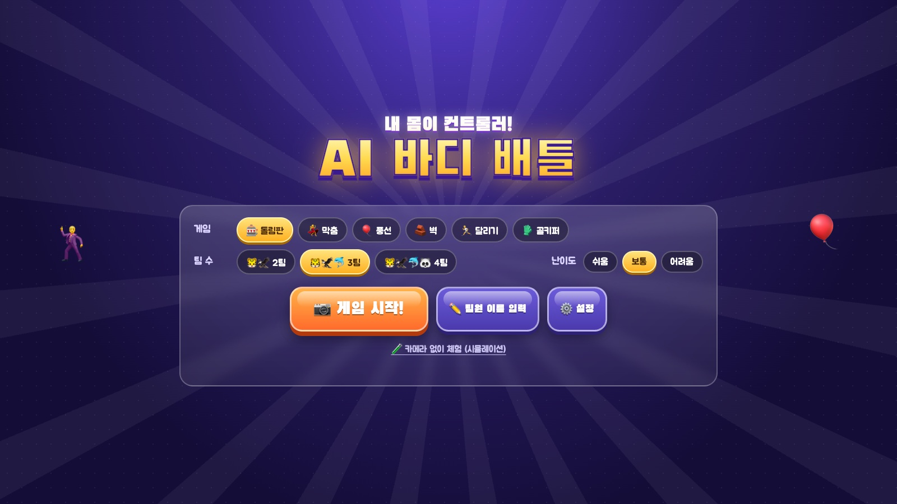
  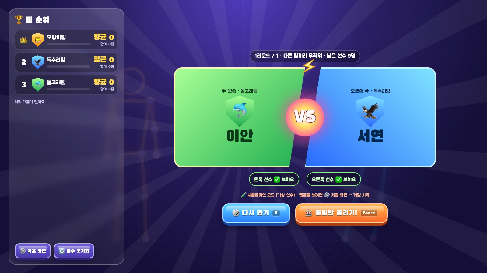
</p>

- **노트북 + 웹캠 + Chrome**만 있으면 돼요. 설치할 프로그램은 파이썬(대부분 이미 있어요) 하나뿐이에요
- **인터넷 없이** 돌아가요 (AI 모델과 글꼴이 폴더 안에 들어 있어요)
- 영상은 **노트북 안에서만** 처리하고 어디에도 보내지 않아요 ([MediaPipe Pose Landmarker](https://ai.google.dev/edge/mediapipe/solutions/vision/pose_landmarker))

## 🚀 팀원용 빠른 시작

### 1. 게임 받기

- 이 페이지 위쪽 초록색 **Code → Download ZIP**을 누르거나, [여기서 바로 받기](https://github.com/ssehai/PostureQuiz_Vision_Model/archive/refs/heads/main.zip)
- 받은 ZIP의 **압축을 풀어요** (Windows는 꼭 "압축 풀기"를 먼저 하고, ZIP 안에서 바로 실행하지 마세요). 폴더 이름은 `PostureQuiz_Vision_Model-main`이에요
- git을 쓰는 사람은 `git clone https://github.com/ssehai/PostureQuiz_Vision_Model.git`

### 2. 게임 켜기

압축을 푼 폴더에서 터미널을 열고 아래 명령을 실행해요. 창은 수업이 끝날 때까지 **닫지 마세요** (끌 때는 `Ctrl+C`).

| 운영체제 | 터미널 여는 법 | 명령 |
|---|---|---|
| **Mac** | 터미널 앱에서 `cd ` 입력 후 폴더를 창으로 끌어다 놓고 Enter | `python3 serve.py` |
| **Windows** | 탐색기에서 폴더를 열고 위 주소창에 `cmd` 입력 후 Enter | `py serve.py` (안 되면 `python serve.py`) |

- `게임 주소: http://localhost:8000`이 나오면 켜진 거예요
- 파이썬이 없으면 [python.org](https://www.python.org/downloads/)에서 설치해요 (Windows는 설치 첫 화면에서 **Add Python to PATH** 체크). 3.7 이상이면 되고, 추가 패키지는 필요 없어요

### 3. Chrome으로 열기

- **Chrome**(또는 Edge) 주소창에 **localhost:8000** 을 입력해요 (파일을 더블클릭해서 열면 카메라가 안 켜져요)
- 카메라 권한을 물으면 **허용**
- TV·프로젝터에 연결했다면 전체 화면으로 (Mac `Cmd+Ctrl+F`, Windows `F11`)

### 4. 수업 진행

1. **처음 화면**: 게임(기본 🎰 돌림판)·팀 수·난이도를 고르고, *✏️ 팀원 이름 입력*에 팀별 명단을 적어요 (한 줄에 한 명). 생명·대결 시간·라운드 수·카메라는 *⚙️ 설정*. 그다음 **📷 게임 시작!**
   - 난이도 기준: 소1~3 **쉬움**, 소4~6 **보통**
2. **대기실**: 컴퓨터가 뽑은 두 선수가 화면 왼쪽·오른쪽에 서요. 아래에 "✅ 보여요"가 뜨면 `Space`
3. 돌림판 → 3·2·1 → 대결 → 결과(`Space`) → 팀 점수판(`Space`) → 다음 대결… 을 반복해요
4. 모두 한 번씩 대결하면 대기실에 **🏆 시상식 보기**가 떠요
5. 다음 학년으로 바꿀 때는 대기실의 **🔄 점수 초기화** → **⚙️ 처음 화면** → 새 명단 입력

| 키 | 동작 |
|---|---|
| `Space` | 돌림판 돌리기 / 다음 화면 / 시상식 |
| `R` | 선수 다시 뽑기 |
| `Esc` | 대결 중단 (점수 없이 같은 대결로 돌아가요) |

> 카메라 없이 연습하려면 처음 화면 아래 **🧪 카메라 없이 체험 (시뮬레이션)** 을 눌러요. 가상 선수 둘이 알아서 움직여요.

### ✅ 수업 당일 체크리스트

- [ ] 수업 전에 그 노트북에서 한 번 켜 보기 (대기실 아래에 **"AI: 이 컴퓨터"** 가 보이면 인터넷 없이도 OK)
- [ ] 웹캠은 삼각대로 **가슴 높이**, 선수는 카메라에서 **3~4m** (어깨·엉덩이까지는 꼭 보여야 해요)
- [ ] 선수 뒤에 다른 학생이 서지 않게, 응원석은 카메라 옆·뒤쪽
- [ ] 두 선수 사이 1.5m 이상, 바닥에 테이프로 서는 자리 표시
- [ ] 노트북이 느리면 ⚙️ 설정의 인식 모델을 **"빠름"**
- [ ] 시간이 빠듯하면 ⚙️ 설정의 대결 시간을 **30초**로

### 🔧 안 될 때

| 증상 | 해결 |
|---|---|
| "권한이 거부됐어요" | 주소창 왼쪽 아이콘 → 카메라 "허용". Mac은 *시스템 설정 → 개인정보 보호 및 보안 → 카메라*에서 Chrome 켜기, Windows는 *설정 → 개인정보 → 카메라*에서 브라우저 허용 |
| "다른 프로그램이 카메라를 쓰고 있어요" | 줌·팀즈·다른 탭 등 카메라를 쓰는 프로그램 끄기 |
| "선택한 카메라를 찾지 못했어요" | 케이블 확인 후 ⚙️ 설정에서 카메라 다시 고르기 |
| "이 주소에서는 카메라를 쓸 수 없어요" | 파일을 더블클릭하지 말고 `localhost:8000`으로 열기 |
| `python3`/`py`를 찾을 수 없다고 나와요 | 파이썬 설치 (Windows는 *Add Python to PATH* 체크 후 터미널을 새로 열기) |
| 8000번 포트를 이미 쓰고 있다고 나와요 | `python3 serve.py 9000`처럼 다른 번호로 켜고 `localhost:9000`으로 열기 |
| 화면이 이상하거나 버튼이 안 눌려요 | `Cmd+Shift+R` (Windows `Ctrl+Shift+R`)로 강력 새로고침 |
| 인식이 끊기거나 느려요 | ⚙️ 설정에서 인식 모델 "빠름", 밝은 곳에서 진행 |

> 점수·팀원 명단은 **노트북마다 그 브라우저에** 저장돼요. 다른 노트북에서는 명단을 다시 입력해요.

## 📸 화면 미리보기

(카메라 대신 🧪 시뮬레이션 모드로 찍은 화면이에요)

| | |
|---|---|
| 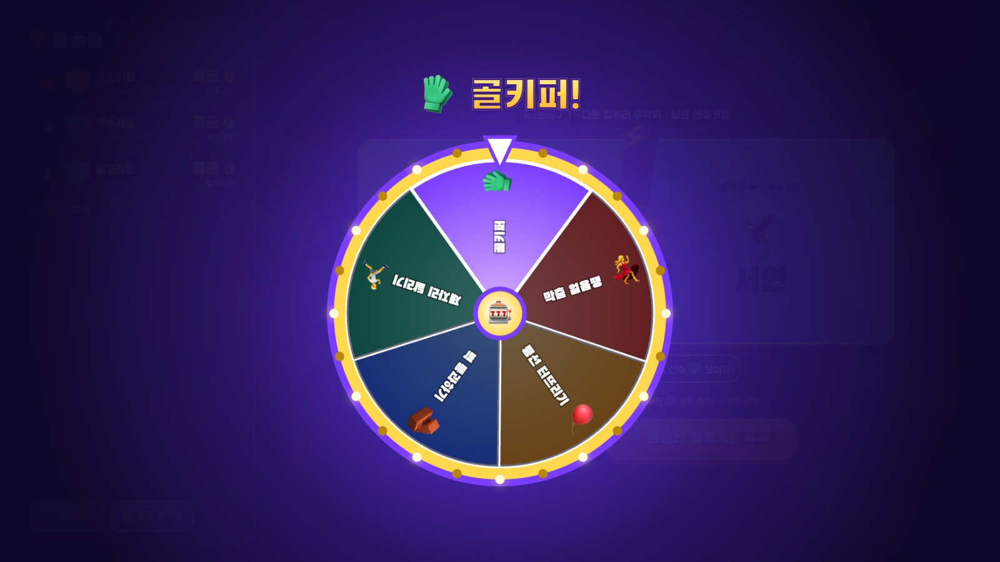 🎰 돌림판 | 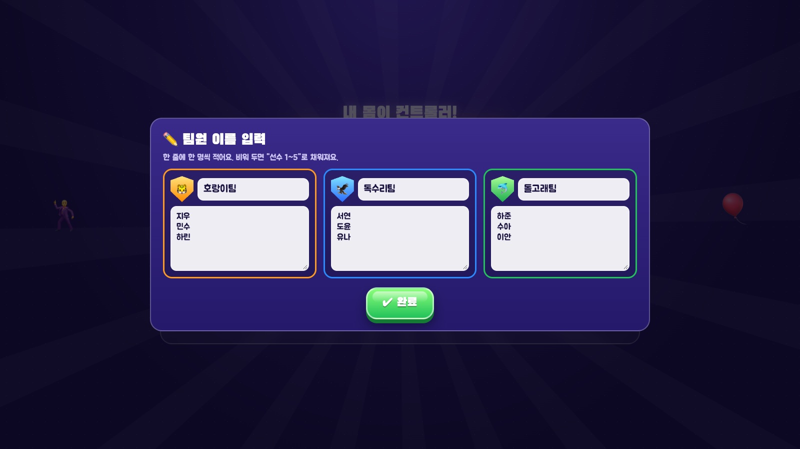 ✏️ 팀원 이름 입력 |
| 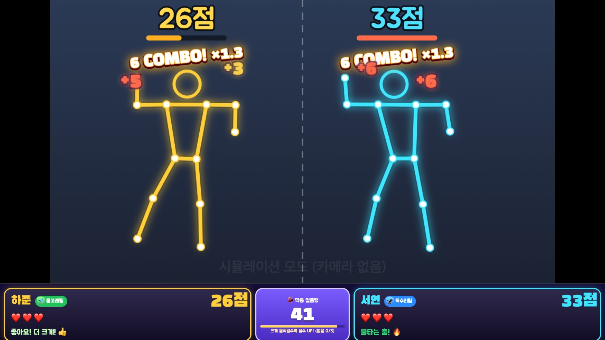 💃 막춤 얼음땡 | 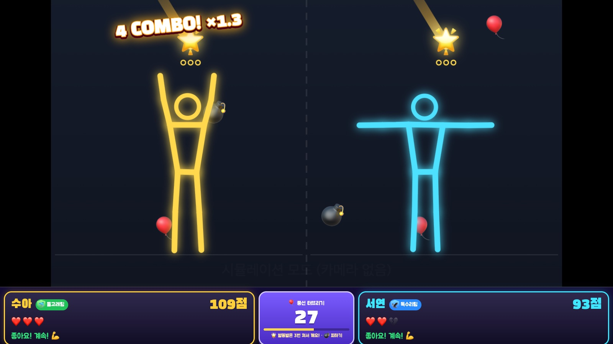 🎈 풍선 터뜨리기 (🌟 별똥별) |
| 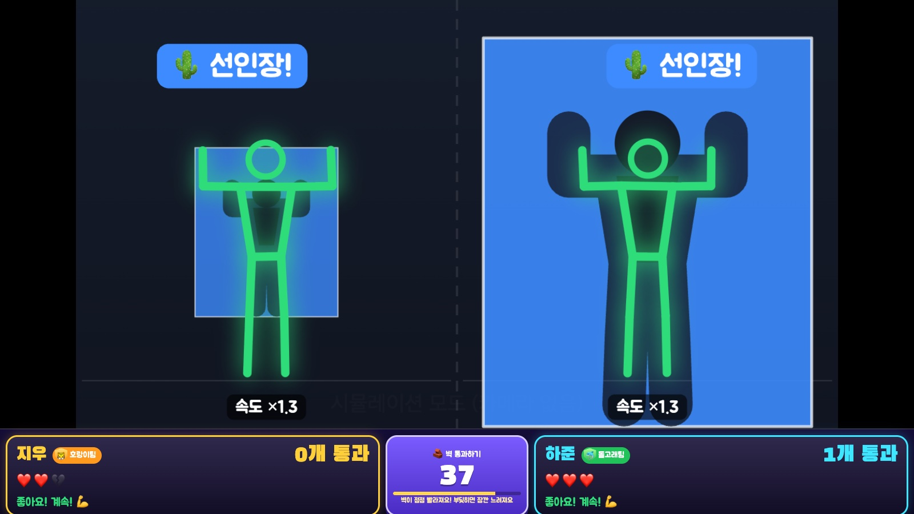 🧱 벽 통과하기 | 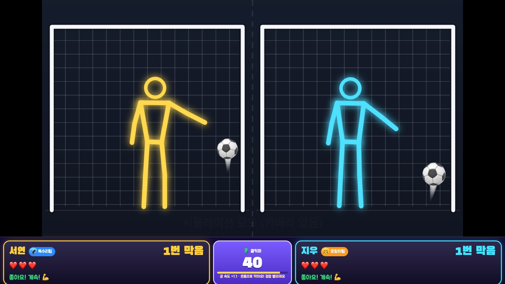 🧤 골키퍼 |
| 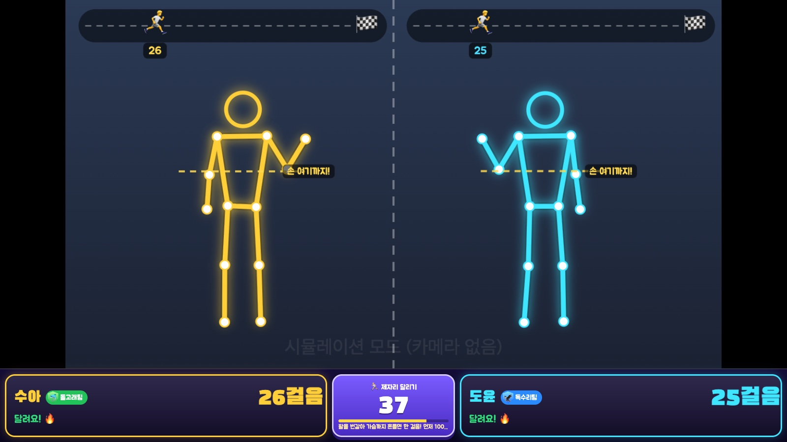 🏃 제자리 달리기 | 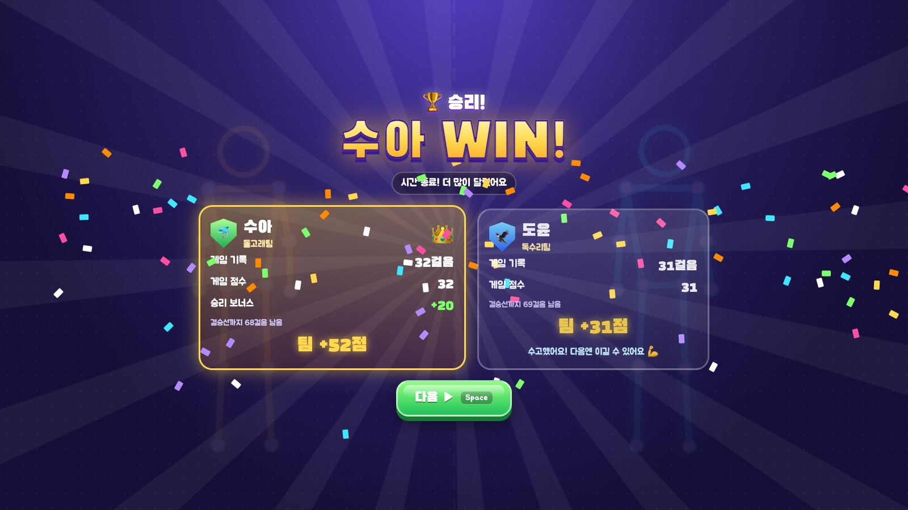 🏆 대결 결과 |
| 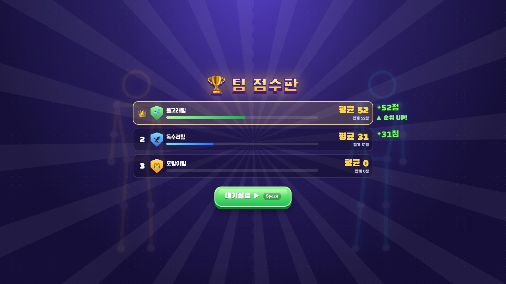 📊 팀 점수판 (순위 변동) | 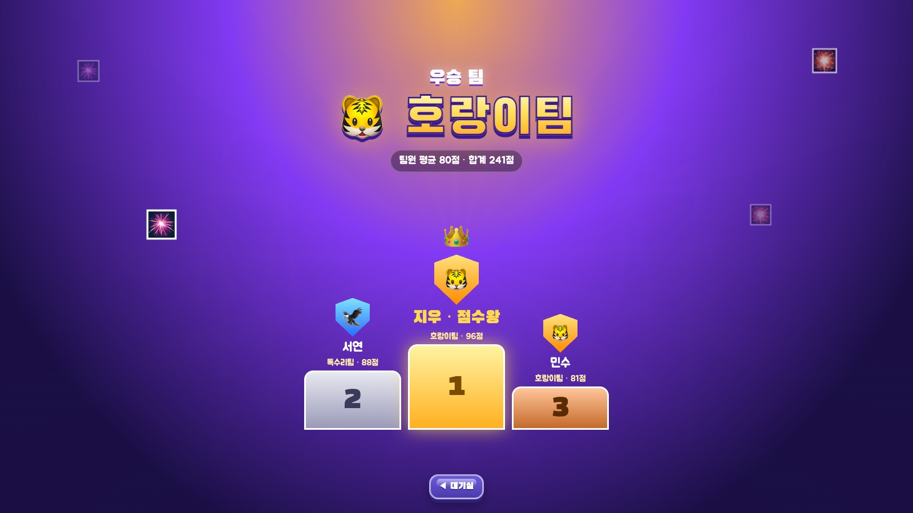 🥇 시상식 |

## 게임 모드

처음 화면의 **게임** 버튼에서 골라요. 기본값은 **🎰 돌림판**이에요. *대결 시작*을 누르면 돌림판이 돌아서 이번 판 게임(댄스·풍선·벽·달리기·골키퍼)을 무작위로 정해요. 바로 전 판과 같은 게임은 나오지 않아요. 한 가지 게임만 하려면 그 게임을 고르면 돼요.

### 💃 막춤 얼음땡

- 따라 할 춤은 없어요. **아무렇게나(막춤) 크고 빠르게 움직일수록** 점수가 쌓여요 (최대 초당 10점, 콤보 배율 별도)
  - 각자 화면 맨 위에 **큰 점수**, 그 아래 **불꽃 게이지**(지금 움직임의 세기), **🔥 콤보**가 보여요. 0.5초마다 얻은 점수가 머리 옆에 "+5"처럼 튀어 올라요
  - **콤보:** 신나게 0.5초 움직일 때마다 +1, 0.6초 멈칫하면 끊겨요. 콤보 1개당 점수 배율 +0.05 (최대 ×2). 10콤보마다 효과음과 함께 알려 줘요
  - 얼음을 생명 안 잃고 버티면 **+20점**, 얼음에서 생명을 잃으면 콤보가 끊겨요
  - 팔다리와 엉덩이가 움직인 속도를 몸통 길이로 나눠서 재요. 가장 많이 움직인 절반의 관절을 쓰기 때문에 팔만 신나게 흔들어도, 온몸으로 춰도 점수가 잘 올라요
  - 카메라 떨림은 움직임으로 치지 않도록 좌표를 부드럽게 만든 뒤 재요
- 대결 시간 안에 **"얼음!"이 무작위로 3번** 나와요 (두 선수 같은 순간). 0.8초 안에 멈추고 3초 동안 버텨요. 움직이면 위험 게이지가 차고, 가득 차면 ❤️ -1이에요
  - 멈춰 있을 때 허용되는 움직임은 난이도로 정해요 (쉬움 0.9 · 보통 0.7 · 어려움 0.5 몸통 길이/초)
- **생명을 다 잃으면 그 선수의 점수는 그 자리에서 멈춰요.** 대결은 시간이 끝날 때까지 계속되고, 시간이 끝나면 점수가 높은 사람이 이겨요

### 🎈 풍선 터뜨리기

- 내 쪽 화면 **전체**에 풍선이 나와요. 손이나 발로 치면 터지고 **🎈 +10점, 작고 빠른 풍선 +20점**이에요
- **🌟 별똥별:** 하늘에서 꼬리를 그리며 비스듬히 떨어져요. **3번 쳐야** 와장창 깨지며 **+50점**(콤보 배율 적용)이에요. 칠 때마다 금이 가고 아래 ●●○로 남은 횟수가 보여요. 손을 대고만 있으면 한 번으로만 쳐요 (떼었다가 다시 쳐야 해요)
- 풍선 종류
  - **제자리 풍선:** 작은 점에서 부풀어 오르다가 다 부풀면 부르르 떨고 펑 터져요 (수명 1.6~3초, 무작위)
  - **떠오르는 풍선:** 아래에서 좌우로 살랑이며 둥실 올라가요
  - **날아가는 풍선:** 옆에서 휙 지나가요. 작은 풍선은 더 빠르고 잔상이 남아요
- 스켈레톤은 **1P·2P 같은 크기로 고정**하고, 옆으로 움직이는 건 그대로 따라가요. 풍선을 쫓아 뛰어다녀야 해요. 높이는 각자 직접 잰 팔 길이에 맞춰서, 팔이 짧아도 위쪽 풍선이 닿아요
- **콤보:** 1.5초 안에 다음 풍선을 터뜨리면 콤보가 이어지고, 콤보 1개당 점수 ×0.1씩 올라가요 (최대 ×2). 폭탄에 닿거나 멈칫하면 끊겨요
- **🔥 피버 타임:** 마지막 10초는 풍선이 두 배로 쏟아지고 별똥별이 많아져요 (폭탄은 줄어요)
- 터진 자리에는 ⭐ 별과 반짝이가 0.3초 동안 튀었다가 사라져요
- **💣 폭탄**에 손·발·머리가 닿으면 ❤️ -1이에요. 폭탄은 제 크기로 '뿅' 나타나고, 2.3초가 지나면 살짝 떨다가 💥 터지며 사라져요 (이때는 벌점 없음). 나타난 직후 0.3초는 닿아도 안전하고, 풍선과는 떨어진 자리에 나와요
- 두 선수에게 같은 순서·같은 종류·같은 움직임으로 나와요. 시간이 끝나면 점수가 높은 사람이 이겨요

### 🧱 벽 통과하기

- 구멍 뚫린 벽이 멀리서 다가와요. 벽이 몸에 닿을 때 **구멍 모양대로 자세를 잡거나, ⬇ 숙이거나, ⬆ 점프**하면 통과예요
- 자세 벽: 만세, 허수아비, 별, 선인장, 한 팔 번쩍, 로봇, **🏺 이집트 벽화, 🐫 걷는 이집트인**, ⚡ 번개, 🫶 머리 위 하트, 🦩 플라밍고
- 자세는 **팔다리 마디마다 어느 방향(위·아래·바깥·안쪽)을 가리키는지**로 판정해요. 팔이 ㄴ자(선인장)인지 ㄱ자(로봇)인지도 구분하고, 팔 하나만 틀려도 통과하지 못해요. 좌우를 바꾼 거울 자세는 정답으로 인정해요
- 내 스켈레톤은 **가로 위치와 크기를 고정**해서 그려요. 카메라에서 가깝거나 멀어도, 옆으로 비켜 서도 똑같은 조건이에요. 세로 위치는 평소 서 있는 높이(최근 5초 중앙값) 기준이라 숙이기·점프는 그대로 보여요
- 벽은 **점점 빨라져요.** 부딪히면 ❤️ -1과 함께 1.6초 무적이 되고, 속도가 절반 가까이 느려졌다가 몇 초에 걸쳐 원래 속도로 돌아와요
- 왼쪽·오른쪽 선수의 벽은 **따로** 움직여요 (벽 순서는 두 선수가 같아요). 시간이 끝나면 더 많이 통과한 사람이 이겨요

### 🏃 제자리 달리기

- 발을 구르지 않고 **달리기 팔 동작**으로 달려요 (아래층 소음 없음). 손을 번갈아 가슴 높이(몸 앞 노란 점선)까지 흔들면 한 걸음이에요
- 같은 팔만 흔들거나 양팔을 같이 들면 세지 않아요. 두 손이 화면에 보여야 해요
- 각자 화면 맨 위 트랙에서 먼저 **100걸음**에 도착하면 바로 승리, 시간이 끝나면 더 많이 달린 사람이 이겨요 (생명 없음)

### 🧤 골키퍼

- 공이 **크게 휘어지며** 날아와요. 처음엔 느긋하게(1.8초) 오다가 1초마다 조금씩 빨라져서 40초쯤 가장 빨라져요(0.75초). 공과 공 사이 쉬는 시간도 처음엔 0.8초로 넉넉해요. 아래 안내에 지금 공 속도(×1.0 → ×2.4)가 보여요. 어디에 떨어질지는 표시하지 않고, 지나온 궤적(꼬리)만 보여요. 공은 팔 길이의 60~105% 거리로 들어오고, 골대 가까이 왔을 때(비행 마지막 18%) **손·팔·몸통·머리·다리 어디든** 닿으면 막아요
- 선수 뒤에 **골대와 그물**이 있어요. 공은 카메라 쪽(화면 아래)에서 크게 날아와 작아지며 골대 안으로 들어가고, 골이 들어가면 그물이 출렁여요
- 스켈레톤은 **1P·2P 같은 크기로 고정**해서 그려요. 카메라에서 멀거나 가까워도 크기가 같고, 위치는 실제로 움직인 만큼(자기 몸통 길이 기준) 자유롭게 따라와요. 공이 떨어지는 거리도 각자 직접 잰 팔 길이 기준이에요
- **온몸으로 막을 수 있어요.** 못 막을 때마다 ❤️ -1이에요 (방금 생명을 잃은 직후라도 예외 없이). 공은 점점 빨라져요. 생명을 다 잃으면 지고, 시간이 끝나면 더 많이 막은 사람이 이겨요

> 풍선·벽·달리기·골키퍼는 두 선수에게 **같은 순서**로 물체가 나오고, 위치는 각자의 **몸통 길이 기준**이라 키가 크거나 팔이 길어도 유리하지 않아요. 자기 자리(화면 절반)에서만 움직이면 돼요.

## 게임 방법

화면은 "밤의 게임쇼 무대" 콘셉트예요 (시안: `design/ui-mockup.html`).

1. **처음 화면**: 게임·팀 수·난이도를 칩 버튼으로 고르고, *✏️ 팀원 이름 입력* 창에서 팀원(한 줄에 한 명)을 적어요. 생명·대결 시간·라운드·카메라는 *⚙️ 설정* 창에 있어요. *📷 게임 시작!*
2. **대기실**: 왼쪽은 팀 순위(평균 점수 막대, 1위 왕관), 가운데는 **VS 카드**(선수 이름 위에 소속 팀 방패 아이콘). 왼쪽/오른쪽에 서서 몸이 보이게 하고 *돌림판 돌리기* (Space)
3. **돌림판**: 테두리 전구가 깜빡이는 돌림판이 돌고, 멈추면 게임 이름이 쾅 떨어져요
4. **대결**: 3, 2, 1 카운트다운 뒤 시작. 남은 10초부터 타이머가 빨갛게 두근거려요. 생명을 잃으면 화면이 흔들리고 하트가 깨져요. 남은 시간과 게임 안내는 화면 **아래 가운데**(두 선수 패널 사이)에 있어서 게임 화면을 가리지 않아요. 생명을 잃은 뒤 1.6초 동안은 무적이에요 (골키퍼의 골은 예외)
5. **승패**: 상대의 생명이 먼저 다 닳으면 승리 (막춤 얼음땡은 제외). 시간이 끝나면 게임 점수로 판정해요. 결과 화면에서 색종이와 함께 팀에 더해지는 점수가 0부터 올라가요
6. **팀 점수판**: 이번 판 점수가 팀 점수에 촤라락 더해지고, 순위가 바뀌면 팀 블록이 미끄러지며 자리를 바꾸고 "▲ 순위 UP!"이 떠요
7. **시상식**: 모든 대결이 끝나면 대기실의 *🏆 시상식 보기*로 우승 팀과 점수왕 1~3위 시상대(소속 팀 아이콘)를 보여 줘요
8. 점수는 브라우저에 저장돼서 새로고침해도 유지돼요 (대기실의 *점수 초기화*로 지울 수 있어요)

### 대회 진행 (팀전, 스위스 방식)

모든 학생이 **똑같은 횟수**만큼 대결해요. 잘하는 학생만 더 많이 뛰는 토너먼트 대신, 라운드마다 전원이 정확히 한 번씩 대결해요.

1. **1라운드:** 무작위로, 가능하면 다른 팀끼리 대결해요
2. **2라운드부터:** 승수가 같은 학생끼리 만나요 (이긴 학생은 이긴 학생끼리, 진 학생은 진 학생끼리). 비슷한 실력끼리 겨루게 돼요
3. **팀 점수:** 한 판이 끝나면 두 선수 모두 **게임 점수(0~100점)**를 자기 팀에 더해요. 이긴 선수는 **승리 보너스 +20점**을 더 받아요. 진 선수도 팀에 점수를 보태요
   - 게임마다 점수 크기가 달라서 0~100점으로 맞춰요: 막춤 점수 × 0.2, 풍선 점수 × 0.13, 벽 1개 6점, 달리기 1걸음 1점, 골키퍼 1번 4점 (모두 최대 100점)
   - **팀 순위는 팀원 한 판당 평균 점수**로 정해요. 팀 인원이 달라도 공정해요 (점수판에 합계도 같이 보여요)
4. **인원이 홀수일 때:** 마지막 한 명은 이미 대결한 학생이 '도우미'로 상대해 줘요. 도우미의 승패·점수는 기록하지 않아요
5. **대회 끝:** 우승 팀, 🏅 점수왕(모든 경기에서 얻은 점수 합계 1~3위), ⭐ 전승 학생을 보여 줘요
6. 라운드 수는 설정에서 1~3으로 고를 수 있어요 (기본 1라운드: 45분 한 교시에 30명 안팎이 모두 한 번씩). 1라운드일 때는 전승 시상을 표시하지 않아요. *점수 초기화*로 처음부터 다시 시작해요

| 키 | 동작 |
|---|---|
| Space | 대결 시작 / 다음 대결 / 다음 라운드 시작 |
| R | 선수 다시 뽑기 |
| Esc | 대결 중단 (점수 없음) |

## 판정 방식

| 항목 | 방법 |
|---|---|
| 몸 크기 | 모든 위치·속도를 **몸통 길이로 나눠서** 재요. 키나 카메라 거리와 상관없이 공정해요 |
| 혼자 할 때 | 한쪽에 아무도 없으면 '빈 자리'로 보고 벌점을 주지 않아요. 한 명만으로 끝난 판은 연습 경기라 기록·팀 점수에 넣지 않고 같은 대결을 다시 대기해요 |
| 화면 밖 부위 | 어깨·엉덩이(몸통)만 보이면 게임할 수 있어요. 허벅지까지만 보이면 **정강이를 허벅지 방향으로 이어서** 조금 흐리게 그려요 (그림·풍선 차기에만 쓰고 자세 판정에는 안 써요). 그 밖에 안 보이는 부위는 회색 점선이에요 |

난이도(쉬움/보통/어려움)는 벽 자세 판정의 허용 각도(`js/arcade.js`의 `LIMB_TOL`, `js/judge.js`의 `DIFFICULTY`)와 막춤 얼음땡에서 멈춤 허용치(`STILL`)를 바꿔요.

## 벽 자세 추가하기

`js/arcade.js`의 `WALL_POSES`에 팔다리 방향(각도)만 적으면 벽 구멍 모양과 판정 기준이 자동으로 만들어져요.

```js
// 0 = 아래, 90 = 몸 바깥쪽 수평, 180 = 위, 180 초과 = 몸 안쪽
makePose({ id: 'egypt', name: '이집트 벽화', emoji: '🏺',
  L: { a: [90, 180], g: [3, 2] },   // a = [윗팔, 아래팔], g = [허벅지, 정강이]
  R: { a: [90, 0], g: [3, 2] } }),
```

## 교실 세팅 팁

- 카메라에서 **3~4m** 떨어져 서야 두 명의 전신이 다 보여요. 노트북보다 USB 웹캠을 높은 곳에 두면 좋아요
- 선수 뒤에 다른 학생이 서 있으면 잘못 인식할 수 있어요. 관중은 카메라 옆이나 뒤쪽에 앉게 해 주세요
- 헐렁한 옷보다 몸 윤곽이 보이는 옷이, 어두운 곳보다 밝은 곳이 잘 인식돼요
- 느린 PC에서는 설정의 *인식 모델*을 "빠름"으로 두세요

## 파일 구조

```
index.html        화면 구성
css/style.css     스타일
js/app.js         게임 흐름(설정·대기실·대결·결과), 그리기
js/poses.js       자세 정의(팔다리 방향 → 스켈레톤 좌표)
js/arcade.js      미니게임 5가지 (막춤 얼음땡·풍선·벽·달리기·골키퍼)
js/judge.js       난이도 기준값, 관절이 보이는지 확인
js/tracker.js     웹캠 + MediaPipe Pose Landmarker
js/sim.js         카메라 없는 시뮬레이션 모드
js/sound.js       효과음 (WebAudio)
serve.py          로컬 서버 (캐시 끔, 파일 형식 지정)
vendor/mediapipe  MediaPipe Tasks Vision 0.10.14 (Apache 2.0, LICENSE 포함)
vendor/models     자세 인식 모델 (lite·full)
vendor/fonts      Jua·Black Han Sans 글꼴 (SIL Open Font License, OFL-*.txt 포함)
design/           화면 시안
docs/screenshots  README 스크린샷
```
